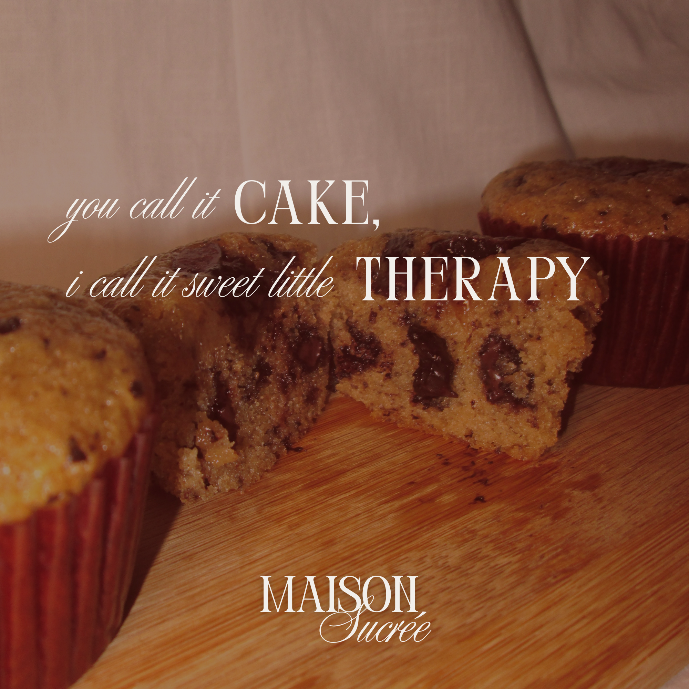
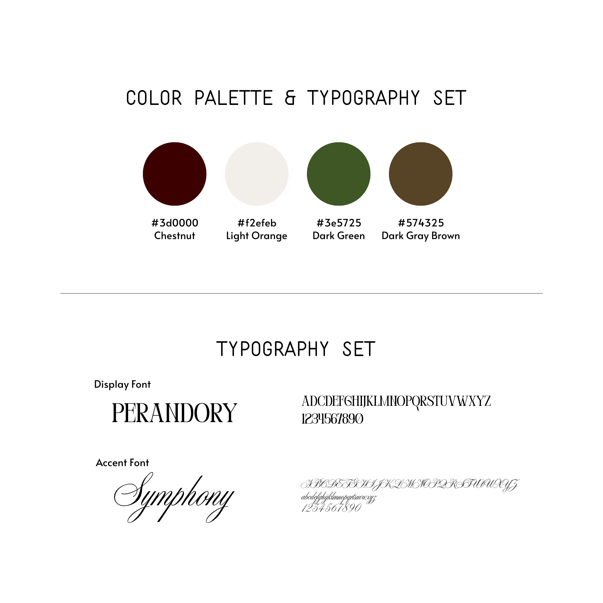

# Activity 2
### Color Palette and Typography

**Maison Sucrée | Branding and Visual Design**

*Creating a consistent and elegant brand identity.*

---

## About the Activity

For this activity, I explored the importance of color palettes and typography in creating a visual identity for a brand.

I used my home-based baking brand, **Maison Sucrée**, as the inspiration for my design. I focused on selecting colors and fonts that would represent the elegant, warm, and homemade personality of the brand.

## What I Learned

This activity helped me understand how colors and typography influence the overall appearance and personality of a brand. I learned that choosing colors is not just about making a design look attractive, but also about creating a consistent visual identity.

One challenge was finding a combination of colors and fonts that complemented each other without making the design look too crowded. I addressed this by focusing on a limited color palette and selecting typography that was both elegant and readable.

In the future, I can apply these lessons when creating promotional materials, digital content, and presentations.

## Skills Developed

- Color theory and color palette selection
- Typography and font pairing
- Visual branding
- Creative design
- Digital presentation

## My Activity 2 Outputs

Here are the designs I created for this activity.

### Personal Logo

### Tagline Design

### Color Palette and Typography

### Header Design

---

[Back to Main Portfolio](../README.md)
