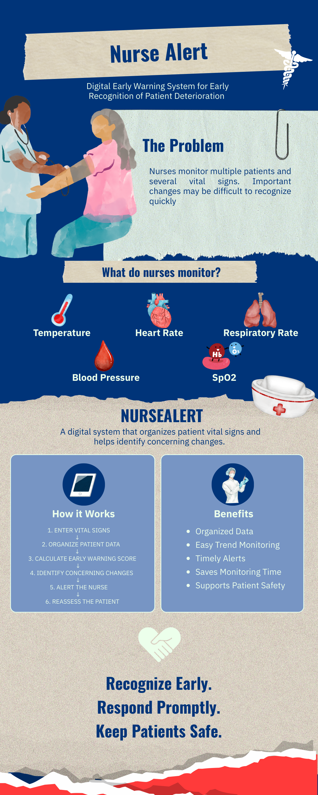

# Activity 3
### NurseAlert: Digital Early Warning System

**Healthcare Technology | Infographic Design**

*Recognize Early. Respond Promptly. Keep Patients Safe.*

---

## About the Activity

For this activity, I created an infographic introducing **NurseAlert**, a proposed digital early warning system designed to support nurses in recognizing patient deterioration.

The infographic explains how monitoring vital signs, organizing patient information, and identifying concerning changes could help nurses respond promptly and promote patient safety.

## What I Learned

This activity helped me understand how technology can support nurses in monitoring patients and recognizing changes in their conditions. I also learned how to present healthcare-related information in a way that is visually appealing and easy to understand.

One challenge was organizing the different features and benefits of NurseAlert without making the infographic too crowded. I addressed this by dividing the information into sections and using illustrations and simple explanations.

In the future, I can apply these skills when creating health education materials, nursing presentations, and other digital resources for healthcare.

## Skills Developed

- Infographic design
- Healthcare technology concepts
- Information organization
- Visual communication
- Creativity and digital literacy

## My Activity 3 Output

### NurseAlert Infographic

[View PDF Version](nursealert-infographic.pdf)

---

[Back to Main Portfolio](../README.md)
